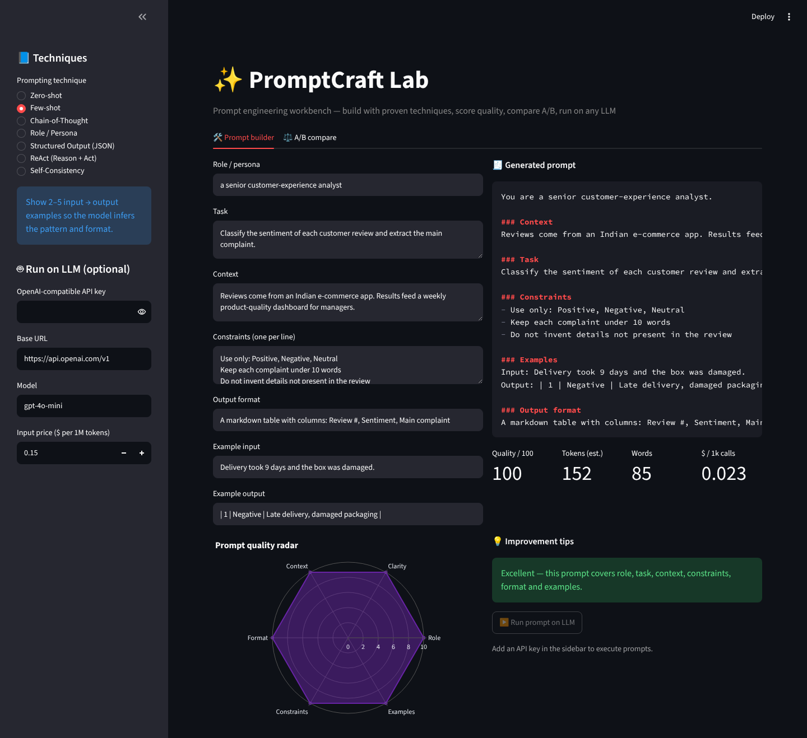
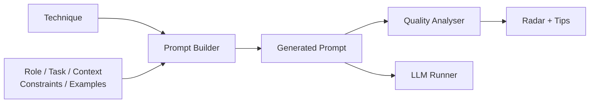
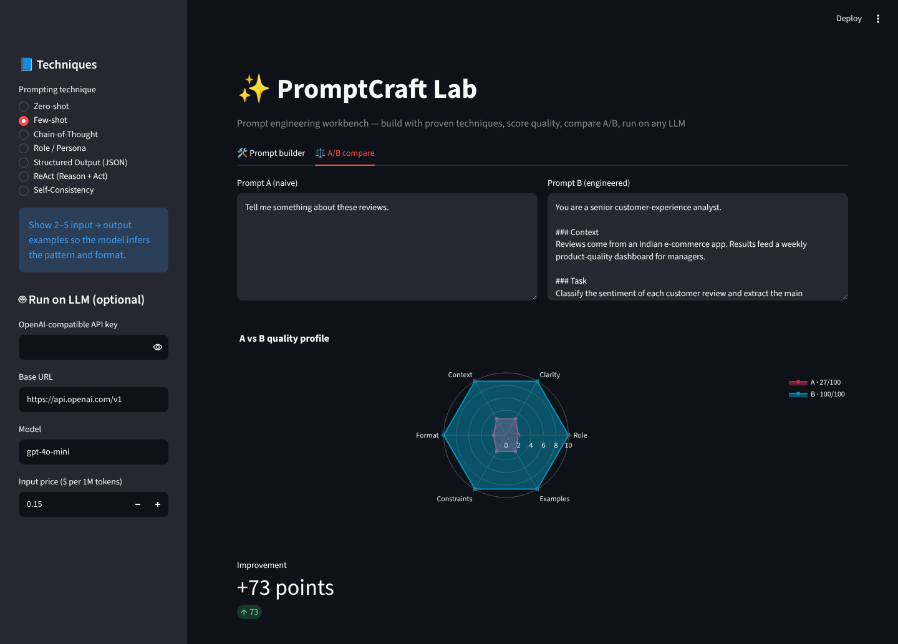

<div align="center">

# ✨ PromptCraft Lab — Prompt Engineering Workbench

**Build prompts with proven techniques, score their quality, compare A/B versions and run them on any LLM.**

    

`Prompt Engineering · LLM Ops`

</div>

---



## 📌 Problem Statement

Most poor LLM outputs come from poor prompts. Teams need a repeatable way to design, review and improve prompts.

## ✨ Key Features

- **7 techniques**: Zero-shot, Few-shot, Chain-of-Thought, Role, Structured JSON, ReAct, Self-Consistency
- Structured **prompt builder** — role, context, task, constraints, examples, output format
- **Quality analyser** scoring 6 dimensions with a radar chart and actionable tips
- Token estimate and **cost per 1,000 calls**
- **A/B comparison** of a naive vs engineered prompt
- One-click execution on any OpenAI-compatible endpoint

## 🏗️ Architecture



## ⚙️ How It Works

1. The builder assembles sections in a best-practice order with markdown headings that LLMs follow reliably.
2. Each technique adds its own scaffold (e.g. CoT answer line, JSON schema, ReAct loop).
3. The analyser checks for role, action verbs, vague words, context, format, constraints and examples → 0-100 score.

## 🖼️ More Screenshots

### A/B comparison


## 🧰 Tech Stack

| Layer | Tools |
|---|---|
| Language | Python 3.10+ |
| ML / Logic | requests |
| UI & Visualisation | Streamlit, Plotly |

## 📁 Project Structure

```
PROMPT-ENGINEERING-LAB/
├── app.py             # Streamlit workbench (builder + A/B tabs)
├── prompt_lab.py      # Techniques, builder, token estimate, quality analyser
├── assets/              # screenshots
├── requirements.txt
└── README.md
```

## 🚀 Getting Started

```bash
git clone https://github.com/PreciousBharath/PROMPT-ENGINEERING-LAB.git
cd PROMPT-ENGINEERING-LAB
python -m venv venv && source venv/bin/activate   # Windows: venv\Scripts\activate
pip install -r requirements.txt
streamlit run app.py
```

Open **http://localhost:8501** in your browser.

> The project ships with a realistic built-in demo dataset, so it runs out of the box with no downloads or API keys.

## 🗺️ Roadmap

- [ ] LLM-as-judge scoring
- [ ] Prompt version history
- [ ] Batch evaluation against a test set

## 👨‍💻 Author

**Bharath** — Software Developer · Project Engineer · Technical Trainer

[](https://linkedin.com/in/connectbharath)
[](https://itsbharathportfolio.netlify.app)
[](https://github.com/PreciousBharath)

⭐ If this project helped you, please give it a star!

## 📄 License

Released under the [MIT License](LICENSE).
